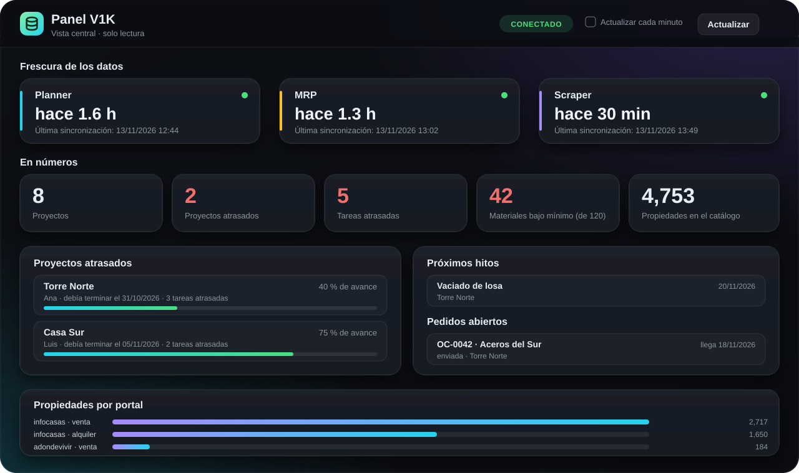
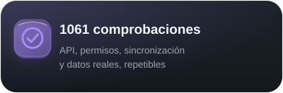

<div align="center">


<br />


<br />


</div>

## ¿Qué es?

Un asistente en **Coze** al que se le pregunta en español por el estado de las obras, los materiales y las propiedades,
y que responde con un resumen de **tres sistemas a la vez**: el *Project Planner*, el *Sistema MRP* y el
*Real Estate Scraper*.

> *«¿Qué proyectos van atrasados?» · «¿Qué materiales tienen mayor faltante?» · «¿Qué propiedades nuevas hay en venta?»*

Las apps viven en servicios gratuitos que se **duermen de 20 a 90 segundos**. En vez de que Coze las llame una por una
y espere, cada app guarda un **resumen** en una base central (Neon) que nunca duerme, y Coze solo **lee** de ella a
través de una API pequeña y de solo lectura.

## Cómo funciona


1. **Cada app escribe su resumen** al guardar datos (y el Planner y el MRP también al arrancar), con un rol propio que
   solo puede tocar sus tablas. La sincronización es idempotente y corre en segundo plano.
2. **La base central** (esquema `central` en Neon) guarda solo resúmenes: 7 tablas y una vista.
3. **`coze-api`** (Vercel) expone 8 consultas fijas de solo lectura, con filtros y protegidas con un token, y lee con el rol
   `coze_reader`. Una de ellas, `resumen_general`, devuelve todo el panorama en **una sola llamada**.
4. **El plugin de Coze** llama a esa API y el **agente** redacta la respuesta. Nunca escribe nada.

## Panel web

La raíz del proyecto de Vercel ya no es un 404: es un **panel de solo lectura** que se abre con el token de la API y
muestra lo mismo que consulta el agente, **sin gastar créditos de Coze**: la frescura de cada app, los indicadores,
los proyectos atrasados con su avance, los próximos hitos y pedidos, el mayor faltante de stock y las propiedades con
filtros por operación, distrito y precio máximo.



- HTML, CSS y JS puros, sin librerías ni recursos externos; funciona en el móvil.
- El token se guarda solo en el navegador (`sessionStorage`; `localStorage` si marcas «Recordar») y «Salir» lo borra.
- Seguridad: política CSP estricta, sin scripts ni estilos en línea, los datos se insertan siempre como texto y los
  enlaces solo admiten `http(s)`.

<div align="center">
<table>
  <tr>
    <td width="33%"></td>
    <td width="33%"></td>
    <td width="33%"></td>
  </tr>
  <tr>
    <td width="33%"></td>
    <td width="33%"></td>
    <td width="33%"></td>
  </tr>
</table>
</div>

## Estructura del repositorio

```
V1K/
├── db/
│   ├── 01_schema.sql              esquema `central`: 7 tablas y la vista v_stock_bajo
│   └── 02_roles.sql               4 roles de mínimo privilegio + seguridad por fila
├── coze-api/                      API de solo lectura y panel web (Vercel)
│   ├── api/[vista].js             función serverless: 8 rutas GET con token
│   ├── lib/vistas.js              consultas cerradas y filtros validados (fuente del contrato)
│   ├── openapi.yaml               contrato para Coze, GENERADO desde lib/vistas.js
│   ├── scripts/                   generar-openapi.mjs
│   ├── public/                    Panel V1K: index.html, panel.css, panel.js, formato.js
│   ├── vercel.json                sirve public/ y añade las cabeceras de seguridad
│   └── test/                      humo, consultas y filtros, contrato OpenAPI y panel
├── tests-integracion/             6 baterías de pruebas contra el sistema real
├── docs/
│   ├── GUIA_PUESTA_EN_MARCHA.md   orden de despliegue, variables, qué se copia y cómo revertir
│   ├── INSTRUCCIONES_AGENTE.md    prompt del agente de Coze y preguntas de ejemplo
│   ├── coze/                      GUIA_SKILLS.md (qué configurar en Coze) y glosario.md (conocimiento)
│   ├── PRUEBAS_REALIZADAS.md      resultados, fallos encontrados y prueba de producción
│   └── assets/                    ilustraciones de este README (SVG)
└── apps/                          NO versionado: copias de trabajo de los repos de las apps
```

| Carpeta | Qué contiene |
|---|---|
| [`db/`](db) | El esquema y los roles de la base central. Se ejecutan una sola vez en Neon, en ese orden |
| [`coze-api/`](coze-api) | La API que consulta Coze y el panel web. Tiene su propio [README](coze-api/README.md) con los endpoints y filtros |
| [`tests-integracion/`](tests-integracion) | Baterías para comprobar el sistema sin leer los registros de Render ni de Netlify |
| [`docs/`](docs) | Guías, el prompt del agente, la configuración de skills de Coze y el informe de pruebas |

## Las tres apps conectadas

La sincronización vive **en el repositorio de cada app** (ya fusionada en `main`):

| App | Repositorio | Pila | Módulo de sincronización | Rol en Neon |
|---|---|---|---|---|
| Project Planner | `InmobiliariaPolyline/planner-backend` | Express · Prisma · Render | `src/lib/vistaCentral.ts` | `writer_planner` |
| Sistema MRP | `InmobiliariaPolyline/Sistema-MRP-EDC-VII` | Python · Streamlit · Supabase | `utils/vista_central.py` | `writer_mrp` |
| Real Estate Scraper | `InmobiliariaPolyline/REAL_ESTATE_SCRAPER` | TypeScript · Netlify · Neon | `api/vistaCentral.ts` | `writer_scraper` |

Para trabajar con ellas en local:

```bash
mkdir apps && cd apps
git clone https://github.com/InmobiliariaPolyline/planner-backend.git
git clone https://github.com/InmobiliariaPolyline/Sistema-MRP-EDC-VII.git
git clone https://github.com/InmobiliariaPolyline/REAL_ESTATE_SCRAPER.git
```

## Puesta en marcha

Los pasos completos, con las variables de cada servicio, están en
[`docs/GUIA_PUESTA_EN_MARCHA.md`](docs/GUIA_PUESTA_EN_MARCHA.md). En resumen:

1. En Neon, ejecutar `db/01_schema.sql` y luego `db/02_roles.sql` (con contraseñas nuevas para los 4 roles).
2. Desplegar `coze-api` en Vercel con `DATABASE_URL_READER` y `API_TOKEN`.
3. Poner `CENTRAL_DATABASE_URL` (cadena de su rol `writer_*`) en el servidor de cada app.
4. Crear en Coze el plugin importando `coze-api/openapi.yaml` y un agente con las instrucciones de
   [`docs/INSTRUCCIONES_AGENTE.md`](docs/INSTRUCCIONES_AGENTE.md).

## Pruebas

Seis baterías, que se pueden repetir cuando se quiera. Las que escriben en la base lo hacen dentro de una transacción
que termina en `ROLLBACK`. Detalle en [`tests-integracion/`](tests-integracion) y en
[`docs/PRUEBAS_REALIZADAS.md`](docs/PRUEBAS_REALIZADAS.md).

| Batería | Qué comprueba | Resultado |
|---|---|---|
| **A · API en vivo** | Autenticación, métodos, rutas hostiles, inyección SQL, filtros y errores 400, `resumen_general`, panel y cabeceras de seguridad, ráfaga de 60 peticiones | 460 / 460 |
| **B · Permisos** | Los 4 roles en Neon: cada tabla × operación, DDL, escapes, RLS, contraseñas falsas | 397 / 397 |
| **C · Sincronización** | El código real del MRP, el Planner y el Scraper con datos extremos | 60 · 46 · 49 |
| **D · Datos reales** | Integridad de lo que hay en la base y que la API devuelva lo mismo, fila por fila | 49 / 49 |

## Seguridad

- **Coze nunca escribe** y nunca ve credenciales de las apps: solo llama a la API con un token.
- **Mínimo privilegio:** `coze_reader` solo tiene `SELECT`; cada `writer_*` solo toca sus tablas y su fila de `sync_estado`.
- **Consultas fijas:** el cliente no puede enviar SQL. Los filtros están en una lista cerrada, se validan (valores permitidos, números, fechas) y viajan siempre como parámetros; un valor no válido da un 400 que explica qué se acepta.
- **Panel web:** CSP estricta, sin scripts ni estilos en línea, sin recursos externos y datos insertados solo como texto.
- **Solo resúmenes:** sin presupuestos, precios, usuarios, contactos ni adjuntos.
- **Apagado por defecto:** las apps sincronizan solo si existe `CENTRAL_DATABASE_URL`.
- **Un fallo nunca rompe una app:** la sincronización es en segundo plano, con límite de tiempo, y solo registra el error sin credenciales.
- **Secretos fuera de Git:** `*.local.*`, `.env` y `secrets.toml` están en `.gitignore`.

## Estado

| Pieza | Estado |
|---|---|
| Base central (Neon) | En producción |
| `coze-api` (Vercel) | En producción |
| Sincronización del Planner (Render) | En producción |
| Sincronización del MRP (Streamlit) | En producción |
| Sincronización del Scraper (Netlify) | En producción: se dispara con cada ingesta |
| Panel web (Vercel) | En producción: se abre con el token de la API |
| Plugin y agente de Coze | Creados; falta actualizar el plugin a 8 herramientas ([guía](docs/coze/GUIA_SKILLS.md)) y la prueba conversacional (créditos) |

## Documentación

| Documento | Para qué sirve |
|---|---|
| [`docs/GUIA_PUESTA_EN_MARCHA.md`](docs/GUIA_PUESTA_EN_MARCHA.md) | Orden de despliegue, variables por servicio, qué se copia, cómo revertir y limitaciones |
| [`docs/INSTRUCCIONES_AGENTE.md`](docs/INSTRUCCIONES_AGENTE.md) | El prompt del agente y preguntas de ejemplo |
| [`docs/coze/GUIA_SKILLS.md`](docs/coze/GUIA_SKILLS.md) | Qué configurar en Coze: plugin, preguntas iniciales, atajos y base de conocimiento |
| [`docs/coze/glosario.md`](docs/coze/glosario.md) | Glosario que se sube como conocimiento del agente |
| [`docs/PRUEBAS_REALIZADAS.md`](docs/PRUEBAS_REALIZADAS.md) | Resultados de las baterías y fallos encontrados |
| [`coze-api/README.md`](coze-api/README.md) | Endpoints de la API y cómo conectarla a Coze |
| [`tests-integracion/README.md`](tests-integracion/README.md) | Cómo ejecutar las baterías |

## Contexto

Proyecto final de la pasantía.
