<div align="center">

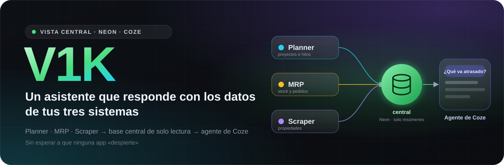

<br />


<br />


</div>

## ¿Qué es?

Un asistente en **Coze** al que se le pregunta en español por el estado de las obras, los materiales y las propiedades,
y que responde con un resumen de **tres sistemas a la vez**: el *Project Planner*, el *Sistema MRP* y el
*Real Estate Scraper*.

> *«¿Qué proyectos van atrasados?» · «¿Qué materiales tienen mayor faltante?» · «¿Qué propiedades nuevas hay en venta?»*


Las apps viven en servicios gratuitos que se **duermen de 20 a 90 segundos**. En vez de que Coze las llame una por una
y espere, cada app guarda un **resumen** en una base central (Neon) que nunca duerme, y Coze solo **lee** de ella a
través de una API pequeña y de solo lectura.


## Cómo funciona


1. **Cada app escribe su resumen** al guardar datos (y el Planner y el MRP también al arrancar), con un rol propio que
   solo puede tocar sus tablas. La sincronización es idempotente y corre en segundo plano.
2. **La base central** (esquema `central` en Neon) guarda solo resúmenes: 7 tablas y una vista.
3. **`coze-api`** (Vercel) expone 8 consultas fijas de solo lectura, con filtros y protegidas con un token, y lee con el rol
   `coze_reader`. Una de ellas, `resumen_general`, devuelve todo el panorama en **una sola llamada**.
4. **El plugin de Coze** llama a esa API y el **agente** redacta la respuesta. Nunca escribe nada.

### Historial y resumen diario

Cada mañana (08:07, hora de Lima) un flujo de GitHub Actions toma **una foto** de los números que importan (proyectos atrasados,
stock, pedidos, propiedades y precios medianos) y te manda por **Telegram** un resumen con lo urgente y los cambios de la semana.
La foto la escribe un 5.º rol, `writer_historial`, que solo puede leer las tablas centrales y escribir su propia tabla. Las apps no
cambian. El historial alimenta la sección **Tendencias** del panel. Cómo activarlo: [`docs/OPERACION.md`](docs/OPERACION.md).

### Los dos bots de Telegram


| Bot | Usuario | Qué hace |
|---|---|---|
| **Resumen diario** | `@v1k_asistente_bot` | Te escribe **solo** cada mañana a las 08:07 (hora de Lima): lo urgente, los próximos días y los cambios de la semana. Solo envía. |
| **Consultas** | `@v1k_consultas_bot` | **Tú preguntas** con comandos y botones (`/resumen`, `/proyectos`, `/materiales`, `/pedidos`, `/propiedades venta miraflores hasta 300000`, `/frescura`, `/tendencias`) y responde al instante. |

Los dos son **privados y de solo lectura**, no usan IA (no cuestan nada y no pueden inventar datos) y solo atienden a los chats que el
administrador autorice. El de consultas además exige un secreto de webhook, de modo que solo Telegram puede llamarlo.

**¿Nunca usaste Telegram?** La guía [`docs/TELEGRAM_PASO_A_PASO.md`](docs/TELEGRAM_PASO_A_PASO.md) explica, desde cero, cómo instalarlo,
registrarte con tu número, buscar los bots, pulsar «Iniciar» y pedir tu acceso:

Al pulsar **Iniciar**, cada bot recibe con una **animación de bienvenida** y, si la persona aún no tiene acceso, le muestra **su número de chat en un
recuadro que se copia al tocarlo** junto con los pasos para pedirlo. Los mensajes usan tarjetas y barras de progreso, y al navegar con los botones el bot edita el mismo mensaje.

<p align="center">
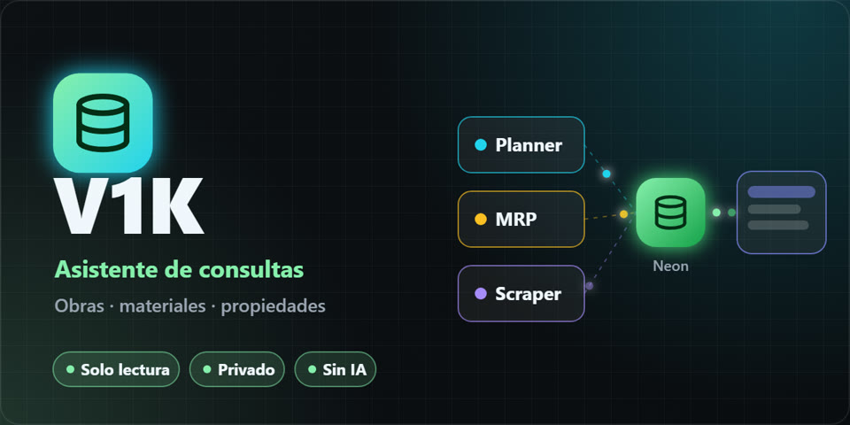
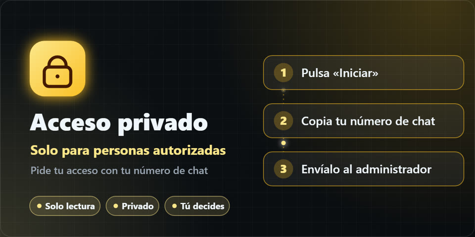
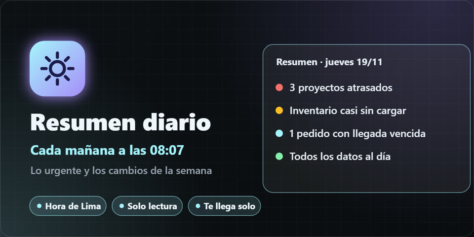
</p>



**Dar acceso desde el panel.** El administrador no tiene que tocar Vercel ni GitHub: en el panel, sección **Accesos de Telegram**, entra con su
token de administrador (distinto del de solo lectura), escribe el nombre, el teléfono y el número de chat de la persona y pulsa **Dar acceso**. El bot le
avisa y desde ese momento puede usarlo y recibir el resumen de la mañana. También puede **revocar** o **quitar** a alguien. El número de chat es lo que
autoriza; el teléfono es solo el registro del administrador. Los nombres y teléfonos viven en una tabla que solo toca un 6.º rol, `writer_accesos`.


Puesta en marcha y administración: [`docs/BOT_TELEGRAM.md`](docs/BOT_TELEGRAM.md).

### Qué pasa cuando una app guarda datos


## Panel web

La raíz del proyecto de Vercel es un **panel de solo lectura** que se abre con el token de la API y muestra lo mismo
que consulta el agente, **sin gastar créditos de Coze**. Tiene once secciones:

| Sección | Qué muestra |
|---|---|
| **Inicio** | Saludo con el estado general, alertas automáticas («qué mirar primero»), indicadores, frescura de cada app, proyectos por estado, faltante de stock por categoría, propiedades por portal, próximos hitos y llegadas |
| **Tendencias** | Cómo cambian en el tiempo los proyectos atrasados, las tareas, el stock, los pedidos, el catálogo y los precios medianos (una foto por día), con variación frente a hace 7 días |
| **Proyectos** | Tarjetas, **línea de tiempo (Gantt)** o tabla; búsqueda, filtro por estado, orden y panel de detalle con los hitos |
| **Calendario** | Hitos en una cuadrícula mensual y una agenda; filtro por proyecto |
| **Materiales** | Stock bajo el mínimo con gráfico por categoría, búsqueda, tabla ordenable y exportación |
| **Pedidos** | Órdenes de compra abiertas con avance de recepción, llegadas vencidas y gráfico por proveedor |
| **Propiedades** | Filtros avanzados (operación, tipo, distrito, portal, precio), tarjetas o lista, estadísticas y distritos |
| **Explorador de API** | Formulario generado desde el contrato de cada vista; muestra JSON, tabla, `curl` y contrato |
| **Agente de Coze** | Preguntas sugeridas con botón de copiar y las herramientas que tiene el agente |
| **Sistema** | Latencia, frescura, preferencias, atajos de teclado y el diagrama de la arquitectura |



- **Pantalla de carga** con el logo de V1K y una barra de progreso real: avanza con los archivos que el navegador va descargando (estilos y módulos), luego con el arranque del panel y la llegada de los datos de la primera sección. Si tarda más de 12 segundos o falla, ofrece recargar.
- **Modo demostración:** el botón «Explorar con datos de ejemplo» abre todo el panel con datos ficticios, sin token y sin llamar a la API.
- Tema claro, oscuro o automático; densidad cómoda o compacta; paleta de comandos (`Ctrl`/`⌘` + `K`) y atajos (`G` + letra, `R`, `T`, `?`).
- Los filtros quedan en el enlace (`#/propiedades?operacion=VENTA&distrito=Miraflores`) y se pueden compartir; exporta a CSV o JSON.
- HTML, CSS y JS puros (módulos ES), sin librerías ni recursos externos; funciona en el móvil y se puede imprimir.
- El token se guarda solo en el navegador (`sessionStorage`; `localStorage` si marcas «Recordar») y «Salir» lo borra.
- Seguridad: política CSP estricta, sin scripts ni estilos en línea, los datos se insertan siempre como texto, los enlaces solo
  admiten `http(s)` y el CSV se protege contra inyección de fórmulas.
- Para verlo en local con las mismas cabeceras que Vercel: `cd coze-api && npm run panel` y abre http://localhost:4173.

<div align="center">
<table>
  <tr>
    <td width="33%"></td>
    <td width="33%"></td>
    <td width="33%"></td>
  </tr>
  <tr>
    <td width="33%"></td>
    <td width="33%">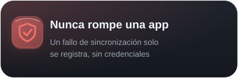</td>
    <td width="33%"></td>
  </tr>
</table>
</div>

## Estructura del repositorio

```
V1K/
├── db/
│   ├── 01_schema.sql              esquema `central`: 7 tablas y la vista v_stock_bajo
│   ├── 02_roles.sql               4 roles de mínimo privilegio + seguridad por fila
│   ├── 03_historial.sql           historial diario (tabla y función de la foto) + 5.º rol, writer_historial
│   └── 04_accesos.sql             accesos del bot de Telegram (tabla, vista de números de chat) + 6.º rol, writer_accesos
├── coze-api/                      API de solo lectura y panel web (Vercel)
│   ├── api/[vista].js             función serverless: 8 rutas GET con token
│   ├── lib/vistas.js              consultas cerradas y filtros validados (fuente del contrato)
│   ├── openapi.yaml               contrato para Coze, GENERADO desde lib/vistas.js
│   ├── scripts/                   generar-openapi.mjs
│   ├── public/                    Panel V1K: index.html, css/, js/ (núcleo y una vista por sección)
│   ├── vercel.json                sirve public/ y añade las cabeceras de seguridad
│   └── test/                      humo, consultas y filtros, contrato OpenAPI y panel
├── .github/                       CI (pruebas en cada cambio), vigilancia cada 6 horas y Dependabot
├── tests-integracion/             6 baterías de pruebas contra el sistema real
├── docs/
│   ├── GUIA_PUESTA_EN_MARCHA.md   orden de despliegue, variables, qué se copia y cómo revertir
│   ├── INSTRUCCIONES_AGENTE.md    prompt del agente de Coze y preguntas de ejemplo
│   ├── coze/                      GUIA_SKILLS.md (qué configurar en Coze) y glosario.md (conocimiento)
│   ├── PRUEBAS_REALIZADAS.md      resultados, fallos encontrados y prueba de producción
│   └── assets/                    ilustraciones de este README (SVG animados)
└── apps/                          NO versionado: copias de trabajo de los repos de las apps
```

| Carpeta | Qué contiene |
|---|---|
| [`db/`](db) | El esquema y los roles de la base central. Se ejecutan una sola vez en Neon, en ese orden |
| [`coze-api/`](coze-api) | La API que consulta Coze y el panel web. Tiene su propio [README](coze-api/README.md) con los endpoints y filtros |
| [`tests-integracion/`](tests-integracion) | Baterías para comprobar el sistema sin leer los registros de Render ni de Netlify |
| [`docs/`](docs) | Guías, el prompt del agente, la configuración de skills de Coze y el informe de pruebas |

## Las tres apps conectadas

La sincronización vive **en el repositorio de cada app** (ya fusionada en `main`):

| App | Repositorio | Pila | Módulo de sincronización | Rol en Neon |
|---|---|---|---|---|
| Project Planner | `InmobiliariaPolyline/planner-backend` | Express · Prisma · Render | `src/lib/vistaCentral.ts` | `writer_planner` |
| Sistema MRP | `InmobiliariaPolyline/Sistema-MRP-EDC-VII` | Python · Streamlit · Supabase | `utils/vista_central.py` | `writer_mrp` |
| Real Estate Scraper | `InmobiliariaPolyline/REAL_ESTATE_SCRAPER` | TypeScript · Netlify · Neon | `api/vistaCentral.ts` | `writer_scraper` |

Para trabajar con ellas en local:

```bash
mkdir apps && cd apps
git clone https://github.com/InmobiliariaPolyline/planner-backend.git
git clone https://github.com/InmobiliariaPolyline/Sistema-MRP-EDC-VII.git
git clone https://github.com/InmobiliariaPolyline/REAL_ESTATE_SCRAPER.git
```

## Puesta en marcha

Los pasos completos, con las variables de cada servicio, están en
[`docs/GUIA_PUESTA_EN_MARCHA.md`](docs/GUIA_PUESTA_EN_MARCHA.md). En resumen:

1. En Neon, ejecutar `db/01_schema.sql` y luego `db/02_roles.sql` (con contraseñas nuevas para los 4 roles). Opcional: `db/04_accesos.sql` para dar acceso al bot de Telegram desde el panel (ver [`docs/BOT_TELEGRAM.md`](docs/BOT_TELEGRAM.md)) y `db/03_historial.sql` para el historial y el resumen diario (ver
   [`docs/OPERACION.md`](docs/OPERACION.md)).
2. Desplegar `coze-api` en Vercel con `DATABASE_URL_READER` y `API_TOKEN`.
3. Poner `CENTRAL_DATABASE_URL` (cadena de su rol `writer_*`) en el servidor de cada app.
4. Crear en Coze el plugin importando `coze-api/openapi.yaml` y un agente con las instrucciones de
   [`docs/INSTRUCCIONES_AGENTE.md`](docs/INSTRUCCIONES_AGENTE.md).

## Pruebas


Las 12 suites sin red de `coze-api` corren solas en cada cambio (**CI**) y cada 6 horas una **vigilancia** comprueba que la API
y el panel respondan y que las tres apps sincronicen: ver [`docs/OPERACION.md`](docs/OPERACION.md).

Seis baterías contra el sistema real, que se pueden repetir cuando se quiera. Las que escriben en la base lo hacen dentro de una transacción
que termina en `ROLLBACK`. Detalle en [`tests-integracion/`](tests-integracion) y en
[`docs/PRUEBAS_REALIZADAS.md`](docs/PRUEBAS_REALIZADAS.md).

| Batería | Qué comprueba | Resultado |
|---|---|---|
| **A · API en vivo** | Autenticación, métodos, rutas hostiles, inyección SQL, filtros y errores 400, `resumen_general`, panel y cabeceras de seguridad, ráfaga de 60 peticiones, webhook del bot de Telegram cerrado | 638 / 638 |
| **B · Permisos** | Los 6 roles en Neon: cada tabla × operación, DDL, escapes, RLS, contraseñas falsas | 690 / 690 |
| **C · Sincronización** | El código real del MRP, el Planner y el Scraper con datos extremos | 60 · 46 · 49 |
| **D · Datos reales** | Integridad de lo que hay en la base y que la API devuelva lo mismo, fila por fila | 55 / 55 |

## Seguridad


- **Coze nunca escribe** y nunca ve credenciales de las apps: solo llama a la API con un token.
- **Mínimo privilegio:** `coze_reader` solo tiene `SELECT`; cada `writer_*` solo toca sus tablas y su fila de `sync_estado`; `writer_historial` solo lee las tablas centrales y escribe su tabla (sin poder borrarla); `writer_accesos` solo toca la tabla de accesos (nombres y teléfonos que nadie más ve).
- **Consultas fijas:** el cliente no puede enviar SQL. Los filtros están en una lista cerrada, se validan (valores permitidos, números, fechas) y viajan siempre como parámetros; un valor no válido da un 400 que explica qué se acepta.
- **Panel web:** CSP estricta, sin scripts ni estilos en línea, sin recursos externos y datos insertados solo como texto.
- **Solo resúmenes:** sin presupuestos, precios, usuarios, contactos ni adjuntos.
- **Apagado por defecto:** las apps sincronizan solo si existe `CENTRAL_DATABASE_URL`.
- **Un fallo nunca rompe una app:** la sincronización es en segundo plano, con límite de tiempo, y solo registra el error sin credenciales.
- **Secretos fuera de Git:** `*.local.*`, `.env` y `secrets.toml` están en `.gitignore`.

## Estado

| Pieza | Estado |
|---|---|
| Base central (Neon) | En producción |
| `coze-api` (Vercel) | En producción |
| Sincronización del Planner (Render) | En producción |
| Sincronización del MRP (Streamlit) | En producción |
| Sincronización del Scraper (Netlify) | En producción: se dispara con cada ingesta |
| Panel web (Vercel) | En producción: se abre con el token de la API |
| Historial diario y resumen por Telegram | En producción: foto y resumen cada mañana a las 08:07 (Lima); lo activa `db/03_historial.sql` más 4 secretos de GitHub ([guía](docs/OPERACION.md)) |
| Módulo «Accesos de Telegram» del panel | En producción: se activa con `db/04_accesos.sql` y dos variables de Vercel (`DATABASE_URL_ACCESOS`, `ADMIN_TOKEN`) ([guía](docs/BOT_TELEGRAM.md)) |
| Bots de Telegram (resumen diario y consultas) | En producción: `@v1k_asistente_bot` y `@v1k_consultas_bot`, de solo lectura y solo para chats autorizados ([guía para usuarios](docs/TELEGRAM_PASO_A_PASO.md)) |
| Plugin y agente de Coze | Creados; falta actualizar el plugin a 8 herramientas ([guía](docs/coze/GUIA_SKILLS.md)) y la prueba conversacional (créditos) |

## Documentación

| Documento | Para qué sirve |
|---|---|
| [`docs/GUIA_PUESTA_EN_MARCHA.md`](docs/GUIA_PUESTA_EN_MARCHA.md) | Orden de despliegue, variables por servicio, qué se copia, cómo revertir y limitaciones |
| [`docs/INSTRUCCIONES_AGENTE.md`](docs/INSTRUCCIONES_AGENTE.md) | El prompt del agente y preguntas de ejemplo |
| [`docs/coze/GUIA_SKILLS.md`](docs/coze/GUIA_SKILLS.md) | Qué configurar en Coze: plugin, preguntas iniciales, atajos y base de conocimiento |
| [`docs/coze/glosario.md`](docs/coze/glosario.md) | Glosario que se sube como conocimiento del agente |
| [`docs/PRUEBAS_REALIZADAS.md`](docs/PRUEBAS_REALIZADAS.md) | Resultados de las baterías y fallos encontrados |
| [`docs/PRESENTACION.md`](docs/PRESENTACION.md) | Guion de presentación de 10 minutos: resumen de una página, demo del panel paso a paso, preguntas probables y lista de verificación |
| [`docs/OPERACION.md`](docs/OPERACION.md) | Pruebas automáticas (CI), vigilancia cada 6 horas, qué hacer según la alerta y cómo rotar el token |
| [`docs/TELEGRAM_PASO_A_PASO.md`](docs/TELEGRAM_PASO_A_PASO.md) | Guía para quien usa los bots: instalar Telegram, registrarse, buscar los dos bots, pedir acceso, comandos y cómo leer el resumen |
| [`docs/BOT_TELEGRAM.md`](docs/BOT_TELEGRAM.md) | Administración del bot de consultas: seguridad, puesta en marcha en 5 pasos, dar y quitar acceso y solución de problemas |
| [`docs/CALIDAD_DE_DATOS.md`](docs/CALIDAD_DE_DATOS.md) | Revisión de los datos reales: inventario sin cargar en el MRP y alquileres «por m²» en el Scraper, y qué se corrigió |
| [`coze-api/README.md`](coze-api/README.md) | Endpoints de la API y cómo conectarla a Coze |
| [`tests-integracion/README.md`](tests-integracion/README.md) | Cómo ejecutar las baterías |

## Contexto

Proyecto final de la pasantía.
