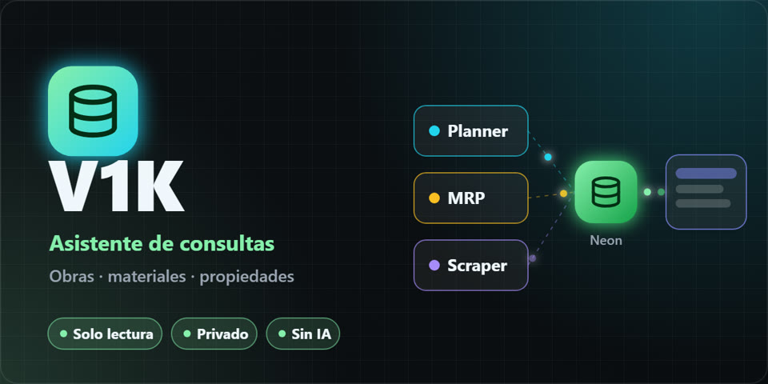

# Bot de consultas por Telegram

Un bot de Telegram que **responde con los datos reales** de las tres apps mediante comandos y botones. Es de **solo lectura**, no usa
inteligencia artificial (no cuesta nada, responde al instante y no puede inventar datos) y es privado: solo contesta a los chats que
tú autorices.

> **Para quien lo va a usar** (registrarse en Telegram, buscar los bots, pedir acceso): [`TELEGRAM_PASO_A_PASO.md`](TELEGRAM_PASO_A_PASO.md).
> Esta página es para quien lo **administra**. Además de este bot existe el **bot del resumen diario** (`@v1k_asistente_bot`), que solo envía.

> No es un segundo Coze: no entiende preguntas libres. Para eso está el agente de Coze. El bot es el atajo para lo que más se pregunta.

## Qué puedes pedirle

Son **16 comandos** en el bot de consultas, agrupados en el menú «/» y en `/ayuda`; el bot del resumen tiene un «briefing» de 6 (`/ahora`, `/alertas`, `/agenda`, `/semana`, `/guia`, `/ayuda`).

| Grupo | Comando | Qué responde |
|---|---|---|
| Hoy | `/resumen` (`/ahora`) | Lo urgente y los cambios de la semana |
| | `/alertas` | Solo lo que requiere atención, con botones al detalle |
| | `/agenda` | Hitos y llegadas de pedidos de los próximos 7, 14 o 30 días, por día |
| Operación | `/proyectos` | **Tabla** con estado, avance, fin y tareas atrasadas; filtros por estado; páginas |
| | `/proyecto V7K` | La ficha de un proyecto con sus próximos hitos |
| | `/materiales` | Los que están bajo su mínimo (tarjetas con barra), con el aviso del inventario sin cargar |
| | `/stock` | **Tabla** de materiales por categoría |
| | `/pedidos` | Órdenes abiertas; filtros `vencidos`, `pendiente`, `enviada`, `parcial` |
| Mercado | `/propiedades` | Avisos con filtros (operación, distrito, tipo, precio), mediana y avisos de precio dudoso |
| | `/mercado` | **Tabla** de precio mediano por distrito, en venta y en alquiler |
| | `/portales` | **Tabla** de avisos por portal |
| Herramientas | `/buscar torre` | Busca en proyectos, materiales, pedidos y propiedades a la vez |
| | `/frescura` | Hace cuánto sincronizó cada app |
| | `/tendencias` (`/semana`) | **Tabla** de cambios frente a hace 7 días |
| Ayuda | `/guia` | Cuándo usar Coze, los bots o el panel |
| | `/ayuda` | La lista de comandos |

**Cada respuesta** trae un encabezado con totales, los datos en tarjetas (`<blockquote>`) o en tablas (`<pre>`, monoespaciado), una línea **💡 de lectura** y el **pie de frescura**
(«🕒 MRP ✅ hace 20 h»), que avisa cuando los datos tienen más de un día. Las listas largas se paginan con botones y los filtros son botones. Todo es de solo lectura.

**Por qué tantos comandos.** Coze cobra créditos por pregunta y solo permite una al día en el plan actual; el bot de Telegram es instantáneo y gratis, así que conviene que cubra lo frecuente.
`/guia` ayuda a decidir: primero un comando, y Coze para lo que no tenga botón. Si escribes una frase suelta, el bot te orienta a `/ayuda`.

## Cómo está protegido

- **Solo lectura.** Usa la misma cadena `coze_reader` y las mismas consultas fijas de la API: no puede escribir ni borrar nada
  (una prueba automática comprueba que el código no contiene SQL de escritura).
- **Privado.** Antes de leer cualquier dato comprueba que el chat esté en `TELEGRAM_CHATS_PERMITIDOS`. A cualquier otro le responde
  «este bot es privado» y su número de chat, sin datos.
- **Solo Telegram puede llamarlo.** Cada llamada debe traer el secreto del webhook (`TELEGRAM_WEBHOOK_SECRET`), comparado en tiempo
  constante; sin él responde 401.
- **Sin inyecciones.** Todo texto que viene de los datos (nombres, títulos) se escapa antes de enviarlo y los enlaces se validan.
- **Sin filtraciones.** Si la base falla, el chat recibe «no pude leer los datos»; el detalle técnico y el token nunca salen.
- **Límite de ráfagas.** Máximo 20 mensajes por minuto por chat.

## Ponerlo en marcha (una sola vez, ~10 minutos)

1. **Crear un bot nuevo** (distinto al del resumen diario). En Telegram abre **@BotFather** (el que tiene la marca azul ✓), escribe
   `/newbot`, elige nombre y un usuario que termine en `bot`. Guarda el **token**.
2. **Anotar los chats autorizados.** Tu número de chat ya lo tienes (el del resumen diario). Para sumar a otra persona: que le escriba
   «hola» al bot nuevo; el bot le responderá su número de chat y tú lo agregas a la lista.
3. **Crear 3 variables en Vercel** (proyecto `v1k-coze-api` → **Settings → Environment Variables**, entorno *Production*):

   | Variable | Valor |
   |---|---|
   | `TELEGRAM_BOT_COMANDOS_TOKEN` | el token del paso 1 |
   | `TELEGRAM_WEBHOOK_SECRET` | un texto largo y aleatorio (24 caracteres o más; solo letras, números, `_` y `-`) |
   | `TELEGRAM_CHATS_PERMITIDOS` | los números de chat separados por comas, por ejemplo `123456789,987654321` |

   Luego **Deployments → Redeploy** para que las tome. (`DATABASE_URL_READER` ya existe.)
4. **Conectar el bot con el webhook.** En `coze-api/`:

   ```powershell
   $env:TELEGRAM_BOT_COMANDOS_TOKEN = "<token>"; $env:TELEGRAM_WEBHOOK_SECRET = "<secreto>"
   node scripts/telegram-webhook.mjs --instalar
   ```

   Publica también el menú de comandos que aparece al escribir «/».
5. **Probar.** Abre el bot, escribe `/resumen`. Para ver el estado del webhook: `node scripts/telegram-webhook.mjs --info`
   (muestra mensajes pendientes y el último error de Telegram, nunca el token).

## Dar o quitar acceso a una persona (módulo «Accesos» del panel)

La persona se registra en Telegram, busca `@v1k_consultas_bot`, pulsa **Iniciar** y el bot le contesta su **número de chat**. Ella te envía ese número
y su teléfono (guía para ella: [`TELEGRAM_PASO_A_PASO.md`](TELEGRAM_PASO_A_PASO.md)). Tú:

1. Abre el panel (https://v1k-coze-api.vercel.app) y entra a **Accesos de Telegram** (menú «Sistema», atajo **U**).
2. Pega tu **token de administrador** (`ADMIN_TOKEN`; es distinto del token de solo lectura del panel). Solo se guarda en memoria, en esa pestaña.
3. Escribe **nombre, teléfono y número de chat** y pulsa **Dar acceso**. Si la persona ya había pulsado «Iniciar», el bot le avisa que ya tiene acceso.
4. Desde ese momento usa el bot (en menos de 15 segundos) y recibe el resumen de la mañana. No hace falta tocar Vercel ni GitHub, ni hacer *Redeploy*.

En la misma pantalla: **Revocar** (sin acceso, pero queda en la lista), **Reactivar** y **Quitar** (la borra). Máximo 50 personas.

| Dato | Para qué sirve |
|---|---|
| Número de chat | Es lo que **autoriza**: Telegram identifica a las personas por él. Es el mismo para los dos bots. |
| Teléfono | Solo es un dato de **tu registro**: Telegram no permite comprobarlo desde un bot, así que no autoriza a nadie. |
| Nombre | Para reconocer a la persona en la lista. |

**Qué ve una persona revocada.** Si alguien a quien pulsaste **Revocar** intenta usar un comando o toca un botón del menú, el bot le dice claro que **su acceso fue revocado**
(no el «bot privado» de quien nunca tuvo acceso): un aviso emergente, el menú desaparece y queda el mensaje con su número de chat y qué hacer si cree que es un error. Con «Iniciar» recibe
la animación de acceso revocado. Al **Reactivar**, vuelve a funcionar en menos de 15 segundos. Quien **Quitaste** de la lista (borrada) vuelve a ver «acceso privado». Los
administradores fijos nunca se tratan como revocados.

**Quién ve qué.** La tabla con nombres y teléfonos (`central.telegram_accesos`) solo la toca el rol `writer_accesos`, y solo desde el módulo. El bot y el resumen
diario leen únicamente la lista de números de chat activos (vista `v_telegram_chats_activos`; el bot también la de revocados, `v_telegram_chats_revocados`); Coze y el panel de datos no la ven.

**Administradores fijos.** Los números de `TELEGRAM_CHATS_PERMITIDOS` (Vercel) y `TELEGRAM_CHAT_ID` (GitHub) siguen funcionando sin aparecer en la lista del módulo: son tu
acceso de respaldo si el módulo o la base fallan. Si la base falla, el bot atiende solo a esos administradores (nadie entra por error).

## Cómo se ve: diseño y bienvenida animada

Telegram no admite SVG, colores ni animaciones dentro del texto, así que el aspecto sale de **tarjetas** (la barra a la izquierda de cada bloque), **barras de progreso**
(▰▰▰▱▱), iconos y negritas, y de una **bienvenida animada** (un MP4 corto que Telegram muestra como un GIF) cuando alguien pulsa **Iniciar**:

| Quién pulsa «Iniciar» | Qué ve |
|---|---|
| Una persona con acceso, en el bot de consultas | Animación de bienvenida, saludo por su nombre, los comandos y el menú de botones |
| Una persona con acceso, en el bot del resumen | Animación del resumen diario, la hora del envío (08:07) y su número de chat |
| Alguien sin acceso, en cualquiera de los dos | Animación de «acceso privado», **su número de chat en un recuadro que se copia al tocarlo** y los 3 pasos para pedir acceso |

Al navegar con los botones, el bot **edita el mismo mensaje** en lugar de llenar el chat de respuestas. El resumen de la mañana usa el mismo diseño; si Telegram
no pudiera interpretarlo, sale igual en texto plano.



**Los videos** están en `coze-api/public/bot/` (`bienvenida.mp4`, `privado.mp4`, `resumen.mp4`) y los sirve Vercel; Telegram los descarga de
`https://v1k-coze-api.vercel.app/bot/<nombre>.mp4`. Si quisieras cambiarlos, edita `coze-api/scripts/banner/banner.html` y ejecuta
`node scripts/generar-banners.mjs` (usa Chrome y ffmpeg del equipo; no corre en Vercel ni en el CI). Si Telegram no puede cargar un video, envía el mismo texto sin él.

**Imagen de presentación (opcional).** Antes de pulsar «Iniciar», cada bot muestra su descripción (la pone el script de instalación). Para ponerle además una imagen o un video:
en @BotFather → `/setdescriptionpic` → elige el bot y envía `coze-api/public/bot/bienvenida.mp4` (o `resumen.mp4` para el bot del resumen). Es manual: la API de Telegram no lo permite.

## Activar la bienvenida del bot del resumen (una sola vez)

Por defecto `@v1k_asistente_bot` solo envía el resumen. Para que también te reciba al pulsar **Iniciar** (con tu número de chat) necesita su propio webhook:

1. **Vercel → Environment Variables** (*Production*, *Secret*): `TELEGRAM_BOT_RESUMEN_TOKEN` (el mismo token que el secreto `TELEGRAM_BOT_TOKEN` de GitHub) y
   `TELEGRAM_RESUMEN_WEBHOOK_SECRET` (un texto largo y aleatorio, distinto del otro). Luego **Redeploy**.
2. **Instalar el webhook** (en `coze-api/`):

   ```powershell
   $env:TELEGRAM_BOT_RESUMEN_TOKEN = "<token>"; $env:TELEGRAM_RESUMEN_WEBHOOK_SECRET = "<secreto>"
   node scripts/telegram-webhook.mjs --instalar --bot resumen
   ```

   También publica su descripción y su comando `/start`. El envío del resumen de la mañana **no cambia** (sigue usando el flujo de GitHub).
3. Probar: pulsa **Iniciar** en `@v1k_asistente_bot`. Ojo: mientras el bot tiene webhook, `resumen-diario.mjs --buscar-chat` no funciona (usa `--borrar` antes si lo necesitas); ya no hace falta, porque el bot te muestra tu número.

## Activar el módulo «Accesos» (una sola vez)

1. **Crear la tabla y el rol en Neon.** En el SQL Editor, con el rol dueño, ejecuta `db/04_accesos.sql` **con una contraseña real en lugar de
   `CAMBIAR_POR_CONTRASENA_LARGA_6`** (el archivo local `db/04_accesos.local.sql` ya la lleva; no se versiona). Es seguro repetirlo.
2. **Crear 2 variables en Vercel** (*Production*, tipo *Secret*): `DATABASE_URL_ACCESOS` (la cadena de `writer_accesos`) y `ADMIN_TOKEN` (largo y aleatorio,
   32 caracteres o más). Ambas están en `db/conexiones.local.txt`. Luego **Redeploy**.
3. **Probar:** panel → **Accesos de Telegram** → pega el `ADMIN_TOKEN`. Debe mostrar la lista vacía y el formulario.
4. Si quieres que el resumen de la mañana también llegue a las personas del módulo, el flujo **Diario** ya usa `HISTORIAL_DATABASE_URL` para leer la lista
   (no hay que crear secretos nuevos: el rol `writer_historial` recibe lectura de la vista en el mismo SQL).

**Seguridad del módulo.** Sin el token de administrador no se ve ni se cambia nada (401). El token de lectura de Coze **no** sirve aquí. Los datos se validan, hay un tope de 50
personas y los errores de la base nunca llegan al navegador. Para cambiar el token: nuevo valor en Vercel → *Redeploy*.

## Si algo falla

| Síntoma | Causa probable |
|---|---|
| El bot no responde nada | El webhook no está instalado (`--info` muestra «ninguno») o falta el *Redeploy* tras crear las variables |
| `--info` muestra «Last error: Wrong response… 503» | Falta alguna de las 3 variables en Vercel |
| `--info` muestra «…401» | El secreto de Vercel no coincide con el usado en `--instalar`: vuelve a instalar |
| El bot responde «Este bot es privado» | El número de chat no está en `TELEGRAM_CHATS_PERMITIDOS` |
| «No pude leer los datos ahora» | La base no respondió; reintenta. Si persiste, mira la vigilancia (Actions) |
| El módulo dice «no está configurado en el servidor» | Faltan `ADMIN_TOKEN` o `DATABASE_URL_ACCESOS` en Vercel, o falta el *Redeploy* |
| El módulo dice «Token de administrador incorrecto» | Estás usando el token de lectura u otro: usa el valor de `ADMIN_TOKEN` |
| El módulo dice «no pudo usar la base de datos» | Falta ejecutar `db/04_accesos.sql` en Neon, o la contraseña de `DATABASE_URL_ACCESOS` no coincide con la del rol |
| Di acceso a alguien pero el bot le dice «privado» | Espera unos segundos (la lista se refresca cada 15 s) y comprueba que el número de chat sea el que el bot le mostró |
| Quieres apagarlo | `node scripts/telegram-webhook.mjs --borrar` (o quita `TELEGRAM_CHATS_PERMITIDOS` en Vercel) |

## Cambiar el token o el secreto

Cambia el valor en Vercel, haz *Redeploy* y vuelve a ejecutar `--instalar` con los valores nuevos. Si el token se expuso, en
@BotFather usa `/revoke` y repite desde el paso 3.

## Para desarrolladores

- Lógica pura y probada sin red: `coze-api/lib/telegram.js` (`procesarUpdate`, `crearManejador`). Endpoint: `coze-api/api/telegram.js`.
- Pruebas: `coze-api/test/telegram.test.mjs`; el endpoint real también se comprueba en la batería A.
- Agregar un comando: una función en `COMANDOS` y su nombre en `NOMBRES_COMANDOS` (el menú de Telegram y las pruebas lo toman de ahí).
