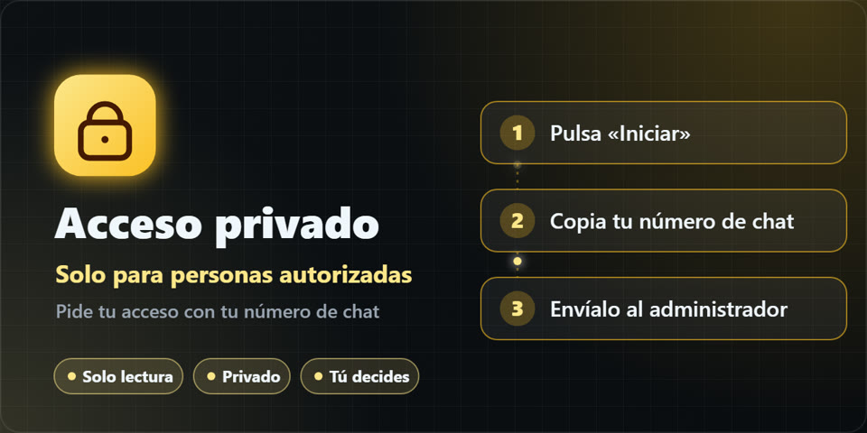

# Telegram para V1K — guía paso a paso

Esta guía es para **quien va a usar los bots**, aunque nunca haya usado Telegram. En unos 10 minutos tendrás tu cuenta, encontrarás
los dos bots y sabrás qué pedirles. No necesitas saber de programación.

## El número de chat, en una frase

El **número de chat** es el número que Telegram le asigna a tu cuenta. **No tienes que buscarlo**: el bot te lo muestra solo cuando pulsas **Iniciar** (dentro de un recuadro, junto al candado). Lo **tocas y se copia**, y se lo
envías al administrador (paso 6) junto con tu nombre y tu teléfono. Él lo escribe en el módulo **Accesos de Telegram** del panel (paso 7) y el bot te avisa «Ya tienes acceso» (paso 8). Es lo único que hace falta: el teléfono
solo queda como registro del administrador, y lo que te autoriza es ese número.

## Los dos bots

V1K tiene **dos bots**. Hacen cosas distintas y los dos son de **solo lectura**: no pueden cambiar ni borrar nada.

| | **Resumen diario** | **Consultas** |
|---|---|---|
| Usuario para buscarlo | **`@v1k_asistente_bot`** (puede verse como «v1kbot») | **`@v1k_consultas_bot`** |
| Enlace directo | [t.me/v1k_asistente_bot](https://t.me/v1k_asistente_bot) | [t.me/v1k_consultas_bot](https://t.me/v1k_consultas_bot) |
| Qué hace | Te **escribe solo** cada mañana a las 08:07 (hora de Lima) con lo urgente del día | **Tú le preguntas** con botones o comandos y responde al instante |
| Tienes que… | Pulsar **Iniciar** una sola vez | Pulsar **Iniciar** y usar los botones |
| Responde si le escribes | No: es solo un buzón de avisos | Sí |

## Paso 1 · Instalar Telegram

- **Celular Android:** abre *Play Store*, busca **Telegram** (el del avión de papel blanco sobre fondo azul) e instálalo.
- **iPhone:** *App Store*, busca **Telegram Messenger**.
- **Computadora:** entra a [telegram.org](https://telegram.org) y descarga *Telegram Desktop* (Windows o Mac). También funciona en
  [web.telegram.org](https://web.telegram.org).

Es gratis y no tiene publicidad molesta.

## Paso 2 · Registrarte con tu número

1. Abre la aplicación y pulsa **Empezar a chatear** (*Start Messaging*).
2. Escribe tu número de celular **con el código de país** (Perú: `+51` y tus 9 dígitos).
3. Telegram te enviará un **código** por mensaje de texto o dentro de otra sesión de Telegram. Escríbelo en la pantalla.
4. Escribe tu nombre (el que verán tus contactos) y, si quieres, una foto.
5. Acepta el permiso de notificaciones: así te llegará el resumen de la mañana. El de contactos puedes negarlo.

> **Cuidado:** el código de verificación es personal. **Nunca se lo des a nadie**, ni siquiera a alguien que diga ser de Telegram o de V1K.

## Paso 3 · Buscar los bots

1. En la pantalla principal toca la **lupa** (arriba).
2. Escribe `v1k_consultas_bot` y toca el resultado.
3. Repite con `v1k_asistente_bot`.

**Para no equivocarte:** existen cuentas falsas con nombres parecidos. Comprueba que debajo del nombre aparezca **exactamente**
`@v1k_consultas_bot` o `@v1k_asistente_bot`, letra por letra. Más seguro aún: toca los enlaces de la tabla de arriba y se abre el chat
correcto. Si tienes dudas, pídele el enlace al administrador.

## Paso 4 · Pulsar «Iniciar»

Dentro del chat del bot toca el botón azul **INICIAR** (*START*) de abajo. Sin este paso el bot no puede escribirte. **Hazlo en los dos bots.**

Al pulsarlo, el bot te recibe con una **animación de bienvenida**. Si todavía no tienes acceso, verás esto: un aviso de acceso privado y **tu número de chat dentro de un recuadro**:

> 🔒 **Acceso privado**
> Este asistente es solo para personas autorizadas.
> Tu número de chat: `123456789`
> **Para pedir acceso**
> 1️⃣ Toca tu número para copiarlo
> 2️⃣ Envíalo al administrador con tu nombre y tu teléfono
> 3️⃣ Te aviso aquí apenas tengas acceso

Es lo esperado: el bot solo atiende a las personas que el administrador autorizó. Los dos bots muestran lo mismo (tu número es el mismo en ambos).

## Paso 5 · Enviar tu número de chat y tu teléfono al administrador

**Toca el número** (está en un recuadro, y al tocarlo se copia solo) y envíaselo al administrador junto con **tu nombre y tu teléfono**, por el medio que ya usan (WhatsApp, correo…).
**Es el mismo número para los dos bots**, así que basta con enviarlo una vez.

El administrador te registra en el panel de V1K y el bot te avisa por sí mismo: «Ya tienes acceso». Si no te llega el aviso, vuelve al bot de consultas y pulsa **Iniciar** otra vez: te recibe con su animación de bienvenida, te saluda por tu nombre y
verás el menú con botones. Desde la mañana siguiente te llegará también el resumen diario.

> Lo que el administrador sabe de ti es solo lo que tú le envías (nombre, teléfono y número de chat). No ve tus contactos ni tus otras conversaciones de Telegram.

## Cómo usar el bot de consultas

Toca los botones o escribe los comandos. Si olvidas alguno, el botón **Menú** (abajo a la izquierda) los lista.

**Hoy**

| Para saber… | Escribe o pulsa | Ejemplos |
|---|---|---|
| Lo urgente y los cambios de la semana | `/resumen` | |
| Solo lo que requiere atención | `/alertas` | con botones para ir al detalle |
| Qué viene en los próximos días | `/agenda` | `/agenda 7` · `/agenda 30` |

**Operación**

| Para saber… | Escribe o pulsa | Ejemplos |
|---|---|---|
| Cómo van todos los proyectos (gráfico) | `/proyectos` | `/proyectos atrasado` · `/proyectos en curso` · `/proyectos torre` |
| La ficha de un proyecto, con sus hitos | `/proyecto` | `/proyecto V7K` (o toca su nombre en la tabla) |
| Qué materiales faltan | `/materiales` | `/materiales cemento` |
| Materiales por categoría (gráfico) | `/stock` | |
| Qué pedidos esperan llegar | `/pedidos` | `/pedidos vencidos` · `/pedidos parcial` · `/pedidos aceros` |

**Mercado**

| Para saber… | Escribe o pulsa | Ejemplos |
|---|---|---|
| Avisos de propiedades con filtros | `/propiedades` | `/propiedades venta miraflores hasta 300000` · `/propiedades alquiler oficina` |
| Precio mediano por distrito (gráfico) | `/mercado` | `/mercado venta` · `/mercado alquiler` |
| Avisos por portal (gráfico) | `/portales` | |

**Herramientas y ayuda**

| Para saber… | Escribe o pulsa | Ejemplos |
|---|---|---|
| Algo en todo a la vez | `/buscar` | `/buscar torre` · `/buscar cemento` · `/buscar OC-1040` |
| Si los datos están al día | `/frescura` | |
| Qué cambió en la semana (gráfico) | `/tendencias` | disponible desde el segundo día de historial |
| Qué usar para cada cosa | `/guia` | Coze, los bots o el panel |
| Ver todos los comandos | `/ayuda` | |

Los comandos con (gráfico) responden con una **imagen**: tócala para verla en grande. **Cada respuesta trae** un resumen arriba (totales, avance medio…), los datos en tarjetas o en una tabla, una línea **💡** con la lectura («2 de 10 proyectos están atrasados») y de cuándo son los datos
(**🕒** «MRP ✅ hace 20 h»; si pasan de un día, avisa que pueden estar desactualizados). Las listas largas tienen botones **‹ Anterior** y **Siguiente ›**, y los filtros son botones: no hace falta escribir.

### ¿Cuál uso: Coze, el bot de consultas, el del resumen o el panel?

| Necesito… | Uso |
|---|---|
| Algo frecuente y exacto (ver lo urgente, un proyecto, un pedido, precios) | **El bot de consultas** (`@v1k_consultas_bot`): instantáneo y **sin costo** |
| Enterarme sin preguntar, cada mañana | **El bot del resumen** (`@v1k_asistente_bot`): te escribe a las 08:07 y responde `/ahora`, `/alertas`, `/agenda`, `/semana`, `/guia` |
| Una pregunta en mis propias palabras, que no tiene botón | **Coze**: entiende lenguaje libre, pero **gasta créditos** (una pregunta al día en el plan actual) |
| Gráficos, calendario o exportar a un archivo | **El panel web** |

Regla práctica: **primero prueba un comando** (es gratis y más rápido) y guarda a Coze para lo que no tenga botón. Con `/guia` el propio bot te lo recuerda.

**Consejos**
- No hace falta escribir acentos: `/propiedades alquiler san isidro` funciona igual.
- Para `/propiedades` puedes combinar: operación (`venta` o `alquiler`), tipo (`casa`, `departamento`, `terreno`, `oficina`, `local`),
  distrito, y precio máximo (`hasta 300000`) o mínimo (`desde 1000`) en dólares.
- Si escribes una frase suelta («¿cómo van las obras?») el bot no la entiende: usa los botones. Para preguntas libres está el
  agente de Coze.
- Cada respuesta trae botones al pie para pasar a otra consulta sin escribir.

## Leer el resumen de la mañana

Llega a las **08:07** desde `@v1k_asistente_bot`. Léelo de arriba abajo:

- **✅ Todo en orden / 🟡 Hay puntos por revisar / 🔴 Requiere atención:** el estado general.
- **Qué mirar primero:** lo más importante, con 🔴 (urgente), 🟡 (aviso) o 🔹 (información).
- **Próximos días:** hitos de proyectos y llegadas de pedidos.
- **Cambios en N días:** qué mejoró o empeoró frente a hace una semana (aparece desde el segundo día de historial).
- **Datos al día:** hace cuántas horas sincronizó cada app. Si alguna pasa de un día, los números pueden estar desactualizados.

## Si algo no funciona

| Qué pasa | Qué hacer |
|---|---|
| No encuentro el bot al buscar | Usa el enlace directo de la tabla de arriba |
| «Tu acceso fue revocado» | El administrador te quitó el acceso. Escríbele con tu número de chat (sale en el mismo mensaje) si crees que es un error |
| «Ese comando es del bot de consultas» (en el bot del resumen) | El bot del resumen solo tiene `/ahora`, `/alertas`, `/agenda`, `/semana` y `/guia`; para lo demás usa `@v1k_consultas_bot` |
| «Este bot es privado» | Envía tu número de chat (Paso 5) al administrador y espera su aviso |
| Pulso un botón y no responde | Espera unos segundos; si sigue igual, escribe `/ayuda` |
| «No pude leer los datos ahora» | Es un fallo momentáneo de la base: intenta de nuevo en un minuto |
| No me llega el resumen de la mañana | Pulsa **Iniciar** en `@v1k_asistente_bot`, y pídele al administrador que confirme que tu número está en la lista |
| Me llegan demasiados avisos | Toca el nombre del bot → **Silenciar**: seguirás pudiendo abrirlo cuando quieras |
| Dudo de un mensaje | Los bots **nunca** piden contraseñas, códigos ni pagos. Si uno lo pide, no es el bot de V1K |

## Para el administrador: dar acceso a una persona nueva

Con el nombre, el teléfono y el número de chat que te envió la persona:

1. Abre el panel de V1K → **Accesos de Telegram** (menú «Sistema») y pega tu **token de administrador**.
2. Escribe nombre, teléfono y número de chat → **Dar acceso**. Si la persona ya pulsó «Iniciar», el bot le avisa solo.
3. Listo: puede usar el bot y recibirá el resumen de la mañana. No hay que tocar Vercel, GitHub ni hacer *Redeploy*.

Para quitar a alguien usa **Revocar** o **Quitar** en el mismo módulo. Detalles técnicos y solución de problemas:
[`BOT_TELEGRAM.md`](BOT_TELEGRAM.md) y [`OPERACION.md`](OPERACION.md).
